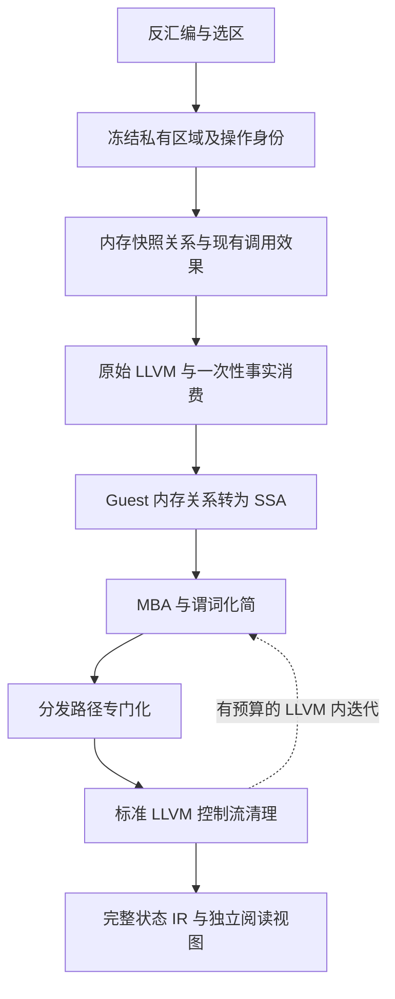

# 去混淆能力补齐实施方案

日期：2026-11-09。设计依据：[问题交接](deobfuscation-design-handoff-20261109.md)、实现基线
`4cd41b7`、文档基线 `a638239`。本文为待实施方案，不表示以下组件已经开发或验证完成。

推荐路线：**先恢复内存读写之间的值关系，再将关系表达为 SSA，最后对有证明的分发路径做改写。**
现有有限值集、调用效果、MBA、谓词、区域提升和 PassPipeline 继续复用。
第一版不建立任意全程序堆分析，也不重写整个反汇编器。

## 1. 对当前问题的重新定位

当前区域提升已使冻结的两个 C O0 ELF 获得 32 次完整 LLVM 根返回匹配；这解决了已测输入的
执行覆盖，分发器仍在。新工作的首要验收是状态关系和分发路径的恢复，不能再把这些原有匹配
报作新增去混淆成果。现有 800/800、无 Z3 668/668 是基线测试结果。

本次重新读取冻结输入后，有一处应纠正的历史描述：当前 `f-combo` 的链表不是由 `megaInit`
直接创建。源码及同一 ELF 的机器码对应如下：

| 位置 | 已核实的行为 | 对方案的影响 |
|---|---|---|
| `megaInit`，`0x10760` | `0x10764` 调用 `SBOX_i$nit`，随后返回 | SBOX 初始化与链表初始化分别分析 |
| `kernel`，`0x109bd` | 调用 ELF 内 `0x15f20` 的分配函数，随后有返回值为零的分支 | 保留分配失败；不能默认链表非空 |
| `kernel`，`0x10a5e/0x10a66` | 从 `0x161e0` 读指针，再写入 `0x161d0` | 可先证明两个全局槽的值相等，不必先求出堆地址 |
| `0x15f20` 的函数体 | 读取/更新 `0x16230`，用 `0x16240` 为基址计算返回值，并有失败路径 | 优先分析真实指令，不能依据名称 `malloc` 宣告新鲜对象或无别名 |

上述最后两项提供了更小的突破口：**未知值也可以有已证明的相等关系**。只收集常量集合不足以
表达这件事。相等关系只在对应写入成功之后成立，遇到可能覆盖的写入或调用必须重新判断。

证据文件为 VM `/home/cc/vmc-runs/pass-pipeline-20261106/tigress-s0/f-combo/` 下的
`transformed.c` 与 `O0/fixture.elf`。ELF SHA256 为
`1f221ba41e5b21c740c229d68bc10348d21aabdb91f612bfaa8be99e83c91a08`；源码 SHA256 为
`d455f19e5615df060b772e907fe5004c1999c06ebc31932a73f685d5e2e335ee`。
这些地址仅用于复现与验收，生产算法不得按这些地址、符号名或固定序言匹配。

## 2. 必须固定的分析契约

### 2.1 三种产物分别标识

| 产物 | 输入前提 | 保证与用途 |
|---|---|---|
| 完整状态基线 IR | 显式选择 StaticAnalysis + FunctionStart；其余合法寄存器、Guest 内存任意 | 保留全部模型状态、内存、调用和 Exit 行为，用作语义基线；不改变库的默认模式/入口策略 |
| 上下文专门化 IR | 明确的调用路径、入口约束及其证明/提供者 | 在列明前提下保持同样的完整状态行为；独立命名，不能替代无条件入口 |
| 阅读视图 | 显式选择的返回寄存器、输出内存、调用事件及控制依赖 | 显示关系、业务 CFG 和切片；第一版为分析图/文本，不伪装成可执行的等价 LLVM 模块 |

FunctionStart 只约束入口 PC，不保证表内容、全局初值、输出指针不与栈别名、初始化执行过、
分配成功或函数正常返回。保持这些前提任意时，一部分所谓不透明谓词实际上随输入内存变化，
不能全部静态删除。这属于输入契约边界，不应靠放松正确性检查解决。

### 2.2 事实来源分级

每条事实记录来源：当前路径的 Guest STORE/LOAD、已证明内部调用效果、CFG 守卫、显式入口约束
或可信插件。程序自身守卫证明的条件可在完整状态 IR 的相应支配域内使用；额外施加于入口的
前提只能进入对应上下文产物，不能约束原无条件入口。
`assumptionsValid` 继续只代表结构合法。普通 image reader、只读 section、符号名和一次执行快照
不能升级为内容证明。

支持调用上下文时，优先从实际调用者或初始化路径推导前提。若从“镜像刚加载”开始，则另建
显式入口场景，记录镜像哈希、映射、重定位、零填充范围与随后执行的初始化代码；此场景不等于
任意函数入口内存。未知外部效果仍是屏障。

可选的安全专门化使用真实条件检查后进入专门化分支，否则走原逻辑；检查自身必须无新增故障、
无副作用，或保留原始故障语义，且在事实使用期间证明不被破坏。单纯保留 `target == case`
检查的快速路径可以改善结构，但不能记作无条件恢复了表内容或完全消除了分发。

## 3. 架构选择



### 3.1 有限值域与表达式关系域互补

保留现有 `Finite / Unknown / Unreachable`，不把 `FiniteValues` 扩成任意符号执行器。
增加内部稀疏关系域，记录 SSA 值身份、有限表达式 DAG、字节提取/拼接及 PHI。
例如 `M[b] = v` 可以成立，即使 `v` 的常量集合为 Unknown。

共同复用地址归一化、写入足迹、寄存器别名规则及调用证明。若要从 `FiniteValues.cpp` 抽出共享
代码，先做行为保持的独立提交，再增加消费者，避免同时改变旧分析和新改写而难以归因。

### 3.2 用实际提升区域作为证明对象

当前 `liftStaticRegion` 可能克隆 Graph、切分块并重新生成 IGNIL。事实必须在此操作之后产生。
新增内部 `PreparedRegion`，持有精确的机器/IGNIL 内容、入口契约和操作 CFG，并供分析与提升共用。
它不是发布到源 Graph 的一组新推断边。

操作 CFG 必须包含区域内每个运行时 target 分支、默认退出、内存失败出口以及正常调用继续条件。
不能直接把原 Graph 中没有后继的间接跳转当成这里的终点；也不能先删候选边再用删过的图
证明这些边不可达。覆盖 case 的 target 相等条件可以参与路径证明，覆盖列表本身不是目标完备证明。

第一版允许保守加入所有覆盖后继和退出，精度不足则保留原 IR。已有有限值/调用引擎通过内部只读
视图适配到同一分析域；无法核对入口、边和效果的旧图结果只作候选提示，不授权改写。

### 3.3 事实桥接与生命周期

建议的内部记录如下，首版不增加 C ABI 中逐条事实的公开结构：

```text
RegionKey = 内容版本 + 架构/配置 + 入口契约 + 覆盖/退出语义
Origin = RegionKey + 解码路径块 + IGNIL op 序号 + 机器 PC + 结果序号
Fact = 关系/值集 + 位宽 + 位点/边 + 前提 + 内存版本 + 依赖与预算结果
LiftSite = Origin + LLVM 值/操作 + 成功检查边 + 故障出口
```

机器 PC 单独不够：重叠解码、同一机器指令的多个 IGNIL 操作、克隆和不同调用上下文都要区分。
UNDEF/未知读取按事件分别标识。哈希用于定位，实际匹配还核对拥有的版本与内容，不依赖裸指针长期存活。

首版选择简单生命周期：事实在精确区域上产生，在刚提升的 LLVM 上一次性消费，之后销毁改写用映射。
`guest-memory-ssa` 必须在通用 LLVM Pass 之前运行；它内部可先构造分析/计划，确认完整后统一提交。
任何先行 IR 修改使旧消费计划失效，不允许靠遗留 metadata 继续使用。后续分发/MBA/谓词直接分析
当前 LLVM SSA；诊断来源信息只用于解释结果。以后若需要二次消费，必须提供重新验证的位点重建器。

这避免第一版要求所有 LLVM Pass 都维护跨层证明。沿用 PassPipeline 的缓存失效规则，跨 run 不自动
保存语义事实。Graph 扩展、入口改变、callee 代码变化、可信前提变化均要求重新准备区域。
S1 只交付本组件所需的区域/位点适配，不先建设通用证明证书平台或重构全部 Graph API。

## 4. Guest 内存转为 SSA 的具体算法

首版采用**保留真实写入的值转发**：不把 Guest 栈槽整体搬入 host alloca，也不延迟写回 Guest 内存。
它恢复值依赖，让 LLVM 看见状态 PHI；调用者和故障出口仍能观察原有内存。

1. 从间接 target、分支条件及候选状态的依赖反向选取内存槽，避免为整张 Guest 内存建 SSA。
2. 地址先支持绝对地址、同一入口 SP 基址加固定偏移，以及已证明相等的地址表达式。
   不同符号基址、Guest 输入指针与栈之间默认可能别名。地址运算遵守机器宽度；一次内存访问的
   字节范围必须与真实 lowering 一致，不能把越界的连续访问擅自改成环绕读取。
3. 在真实 STORE 的成功后继记录已存 SSA 值。按字节保留部分覆盖，读时按真实端序及位宽重建。
   唯一地址可强更新，多候选写只失效可能覆盖的并集；未知写清除可能受影响的关系。
4. LOAD 若没有可用关系，保留真实 LOAD，其成功后继可记录这次读取的值快照。后续相同地址且无
   可能覆盖时，可复用这个 SSA 值，即便值本身未知。两个独立读取不能仅因地址文字相同就合并。
5. 所有可达前驱都有合法值定义时，建立 PHI；有未知前驱则保留原 LOAD。建立 PHI 不搬动原读取，
   不在原来不读取的路径预读内存。首版不使用 `undef`/`poison` 给缺失前驱补值。
6. 循环先求“所有入口/回边都有有效定义”的保守不动点，再构造循环 PHI。循环入口不得以回边事实
   自证已初始化；预算失败或缺失定义时放弃该改写计划。SSA 可表示不断变化的状态，不必枚举其所有值。
7. 保留每次原始访问的边界检查、执行位置和失败时完整状态。替换 LOAD 的结果不自动授权删除检查。
   STORE、调用、可观察寄存器和 Exit 仍保留；最终由具备相应证明的标准优化删除确实冗余的部分。
8. CALL 默认失效所有相关值。已有调用证明只在真实正常返回继续边上恢复确定未改字节及写后关系，
   保留 CALL、机器压栈/LR、返回目标检查和寄存器重载。没有把“正常返回效果”升级为必返回或无故障。

将单条转发条件概括为：对该 LOAD 的每次允许执行，读取地址相同、每一读取字节都来自已知到达
定义、沿途没有未处理的可能覆盖，且替代 SSA 定义支配其使用；否则不替换。

LLVM MemorySSA 可用于加速查找内存依赖，但它本身不会把 Guest 字节变成标量值，也不能证明
两个 Guest 地址不别名。按 LLVM 21 的模型，MemoryPhi 合并的是可能到达的内存定义，仍需上述
别名与字节内容检查。[LLVM 21 MemorySSA](https://releases.llvm.org/21.1.0/docs/MemorySSA.html)

## 5. 表内容与分发器改写

### 5.1 表内容分为三条路径

| 情况 | 实现 |
|---|---|
| 函数内 STORE 建表 | 从同一内存 SSA 得到各表项关系；守卫、索引、地址运算、表项宽度/符号扩展分别验证 |
| 内容依赖调用前初始化或镜像初值 | 只在相应已证明/显式提供的上下文中读取事实；写入、别名和调用继续失效它们 |
| 内容无法证明 | 保留实际 LOAD、实际 target 和完整默认退出；允许报告候选，不发布虚假的完整集合 |

常量 state 不等于常量 target。相对表的符号扩展、缩放和基址加法必须按实际机器位宽计算。
有限枚举必须完整，超预算退 Unknown；不能取前 N 个表项继续删边。
若额外支持入口表内容检查，检查通过的路径也必须证明后续没有破坏；此优化单列为受检查的专门化。

### 5.2 去平坦化采用按入边专门化

识别“循环内反复写状态，再经共同选择器返回业务块”的候选。识别仅决定优先级，不是删除依据；
有自然 switch 的输入不必消除 switch。对每个候选入边：

1. 代入该边对应的 PHI 值，结合支配守卫，求下一 target 表达式。
2. target 可证明唯一时，将该路径的终结转移改成直连；形如 `select c, A, B` 时，保留同一真实
   条件的两条边。只有集合 `{A,B}` 而没有可证明的选择条件时，不能任意选择目标。
3. 必须保留分发段中的寄存器/标志写入、内存检查、STORE、调用和退出。首版只在线程化后的
   副作用前缀之后替换终结 switch；必要时有界克隆前缀，按原顺序执行一次。含未知调用、局部 REP
   或复杂循环的前缀首版拒绝克隆。不能直接绕过整个 dispatcher 块。
4. 更新 successor PHI、支配关系与循环结构；不能保留指向已删除入边的值。每次提交后 verify。
5. 未证明的入边继续走原 dispatcher。只有所有仍可达入边都已处理且副作用仍被正确执行，才允许
   删除原分发段。缺失目标、异常、未知默认路径保持显式退出。

使用当前 LLVM SSA 和精确前驱边作证明，不从动态轨迹收集下一状态。先复用现有
`control-flow`；标准步骤无法处理的、已经证明的边才交给新增 `dispatch-specialize`。
首先支持单一常见 dispatcher，再做多个有界 dispatcher；不要求首版化简任意不可约 CFG。

## 6. 谓词、MBA 和跨调用的增量扩展

### 6.1 谓词按证明成本分层

第一层仍是现有全输入代数证明。第二层增加支配守卫、边限定 PHI、相同内存快照/复制关系：
例如在 `p != 0` 的支配边下复用非空事实，或者利用已成功执行的 `list2 = list1`。
只取对该位点所有可达执行都成立的条件；多前驱 PHI 逐边处理或保留，不把某一条路径条件当成整个块前提。

折叠恒真条件时证明 `路径条件 && !条件` 不可满足；恒假类似。路径条件的来源必须可靠。
对循环只用已证明的归纳不变量，有限展开的结果不足以删除剩余迭代。SAT、Unknown、超时均不折叠。

### 6.2 MBA 先改善输入关系和预算分配

继续使用现有真值签名提案和完整字长 UNSAT 检查。先让重复 LOAD 合并成同一 SSA 输入，再评估
三输入限制是否仍是瓶颈。优先处理 selector、分支和指定业务输出的依赖；随后轮转处理其他区域，
避免模块前部状态/标志辅助表达式耗尽全部预算。

增加精确的截断/扩展边界提取，跨 PHI 只在明确前驱条件下提取；完整证明仍包含实际位宽转换。
超过预算的根保留，不能把不同加载或不同 freeze 强行合并以减少变量数。超过三变量的算法作为后续
独立组件，根据实际覆盖证据决定，第一版不承诺通用非线性 MBA。

改写需保证 LLVM 的 definedness：不引入原路径没有的除零、越界移位或 poison，不移动可能出错
的求值到新路径。普通位向量等式不足以覆盖这些条件。现有拒绝 undef/poison/不支持 flags 的策略
继续生效。[LLVM 21 UB 说明](https://releases.llvm.org/21.1.0/docs/UndefinedBehavior.html)

### 6.3 调用摘要先接消费者，再扩分析域

先把 `LeafCallProof` 已证明的写集、常量和未改字节接到内存转发；保持当前 x86、调用树与循环预算。
其次为小型实际内部函数增加有界符号结果：`返回值 = 表达式`、`内存槽 = 入参/入场快照表达式`，
以及沿条件分支成立的效果。缓存键必须包含代码版本、完整相关入口约束、内存依赖和证明选项。
初版不做未经验证的上下文裁剪；优化缓存先单独证明读依赖集合足够。

再扩到已证明的绝对全局单元和有限对象区间。针对当前冻结输入，先静态分析实际分配函数及
`kernel` 内初始化循环，保留容量不足、零返回、指针别名和输出可能覆盖全局/表的情况。
该函数体存在并不保证能在任意初始内存下证明“新鲜且成功分配”，尤其不能只看函数名。

对未提供函数体的外部 allocator，默认 Unknown。需要额外环境模型时，通过现有可信 Pass 插件
显式提供并标注前提，不偷偷内置名称特判。一般堆图、不定长链表和未知外部副作用不纳入本轮必达范围。

## 7. Pass 顺序与报告

默认 `optimize()` 的六步顺序及原入口保持兼容。新增显式 deobfuscation 配置，内部仍组合已有
Graph/LLVM 管线，不把它们混成一个违反阶段检查的 PassPipeline。

```text
区域准备：选区/补充解码 → 私有重建 → 自定义 IGNIL 变换 → 冻结版本
一次阶段：原始提升 → guest-memory-ssa（含事实验证/消费）
LLVM 循环：mem2reg → instcombine → gvn → mba → predicates/path-predicates
          → dispatch-specialize → control-flow → dce
输出阶段：完整状态 IR + 证明/未解决原因报告 + 可选阅读视图
```

已有“先变换 IGNIL 再 rebuild”的调用不能静默转换成上述顺序：严格模式保留调用者 IGNIL；
机器重建模式必须把变换移到重建之后。不能既丢弃变换又声称其收益保留。

重复阶段仅处理当前 LLVM；首版最多 3 轮并共享本次运行的总求解/展开额度，不每轮重新发放无限预算。
默认普通管线预算不变。每步无变化且没有剩余计划时停止；有预算退出时不得报告分析已收敛。
原 `pipeline.converged` 仍只表示 IR 不再变化；新增总体报告另列 `analysis_complete`，不偷换现有字段含义。
在先前已完整证明的独立改写之后发生预算退出，可以保留这些改写；未完成不动点或半份区域计划全部丢弃。

建议额外报告：槽/字节数、读取复用、STORE 转发、PHI、调用屏障、别名屏障、条件事实数量、
SMT 的 UNSAT/SAT/Unknown、预算退出、已线程化入边、仍未解决的分发位点与原因。
理由用稳定代码，例如 `may_alias`、`entry_memory_unknown`、`callee_unproved`、`missing_decode`、
`unsupported_expr`、`budget_exhausted`；每个结论附机器来源，便于自定义 Pass 接入。

`Unavailable` 表示能力不存在，`Incomplete` 表示覆盖/证明未完成，`Error` 表示错误并丢弃产物。
`Success` 和 `converged` 均不表示去混淆全部完成。证明记录是可审计的依据，不宣称框架已有通用形式化验证器。

## 8. 分阶段开发与提交

下列文件名中未存在的均为建议新增文件。一个阶段可拆成多个可独立验证的提交，不以“大补丁合并”替代回归。

| 阶段 | 可交付结果 | 主要修改点 | 合入门槛 |
|---|---|---|---|
| S0 验证与定位 | 修无 Z3 可选诊断、冻结目标依赖及明确失败基线 | `block_deobf_study.py`、`finite_vm_replay.py`、`static_region_replay.py`、测试报告 | 诊断 unavailable 与语义失败分开；没有漏跑或误计通过 |
| S1 事实基础 | 精确区域、入口/来源身份、一次性映射；默认行为不变 | `LLVMLifter.cpp/.hpp`、内部 `PreparedRegion` / `LiftProvenance`，对应 tests | 错区域/旧映射/新入边/入口变化拒绝；普通 IR 兼容 |
| S2 内存 SSA 第一版 | 无调用的 LOAD 复用、STORE 转发、部分写、汇合/循环 PHI | 新 `GuestMemorySSA`、`LLVMLifter.cpp`、`PassPipeline.cpp` | 三架构对拍；真实当前样本至少出现有来源可核查的值关系恢复 |
| S3 现有调用与路径关系 | 接已有摘要；全局复制关系、支配谓词、MBA 调度 | `LeafCallEffects` 适配、`LLVMPredicateFolding.cpp`、`LLVMMBASimplification.cpp` | 不删 CALL；正常/非正常返回、别名和路径负例通过；有独立新增收益 |
| S4 表与去平坦化 | STORE 建表及可证上下文，按入边恢复直连 | 新 `LLVMDispatchSpecialization.cpp`、`TableContents.cpp` 适配、注册/报告 | 常见平坦化恢复业务边；输入依赖 switch、默认出口和副作用保持 |
| S5 有界初始化与全局效果 | 当前 combo 剩余初始化/小分配函数的条件关系 | `LeafCallEffects.cpp/.hpp`、内存关系域、上下文产物接口 | 对成功、失败、别名、改表及重复调用逐项验收；未证明部分仍明确保留 |
| S6 产品化与泛化验收 | 自动有界选区、阅读视图、C/Python 配置、成本控制 | 区域准备、C shim/Python、验证脚本及 docs | held-out 样本、无符号、C O2、适用递归策略及全套回归 |

S2 与 S3 先只接最小机制，不等 S5 完成一般堆能力。S4 的普通栈状态机可先验收，当前 combo 的
完整收益可能依赖 S5，二者不能混报。S6 的资源计数和测试基础从 S0 开始建设，最终阶段才集中验收。

第一轮具体任务建议限为 S0、S1、S2：交付一个能把真实 Guest 槽值接到 SSA 的组件。先用
`STORE slot, select(c, A, B); ...; LOAD slot` 的循环机器码以及全局复制反例跑通，再用冻结 combo
检查实际全局关系；不同时开工整个堆分析和完整去平坦化。

实施投入估计：S0–S2 约 8–14 个工程工作日；S3–S4 再 10–18 日；S5 再 8–15 日，置信度较低；
S6 集成验收再 5–8 日。包含开发、旧版失败对照和差分验证，串行约 6–11 周；是规划量级，
不是代理后台执行或固定日期承诺。首个 S2 真实收益检查点后根据别名/表内容阻塞重新估算。

## 9. 验收矩阵

### 9.1 必须固定的反例

| 类别 | 必测正例与负例 |
|---|---|
| 值转发 | 同址无写、同址不同快照、未知入口首次 LOAD、截断/扩展、8/16/32/64 位交叠、宽 STORE 失效 |
| 别名 | 输出指针恰好等于状态槽/表/全局、部分重叠、不同基址可能相同、模地址计算边界 |
| CFG | 菱形同值/异值、一条路径未初始化、循环零/一/多次、未知回边、重叠解码后的块切分 |
| 调用 | 改状态、只改不相交字节、相同参数但不同内存、未知外部、失败退出、改返回地址、嵌套调用 |
| 表 | 函数内初始化、写后改变表项、部分初始化、相对有符号表项、边界索引、外部 target、未覆盖块 |
| 去平坦化 | 常量/条件下一状态、有副作用分发前缀、真实业务 switch、多个入边、PHI、循环与代码膨胀上限 |
| 语义出口 | 内存失败时 PC/Flags/已发生写入、Unknown/Transfer、不返回行为、拒绝内部外部入口 |
| 初始化 | 初始全局非零、allocator 失败、分配游标变化、两次调用、输出破坏链表/表、显式前提不满足 |
| 生命周期 | 原图与私有图不一致、块重建后旧 op 索引、LLVM 先行改写、callee 修改、预算中断后再次运行 |

### 9.2 每阶段三份独立成绩

1. **语义**：原始机器码的 Unicorn/必要时第二参考，对照最终实际加载的 LLVM 库输出，检查全部
   模型字段、完整测试内存、PC/SP、七字段 Exit 和调用边界；O0/O2，零/一/符号位/极值及专门别名输入。
   表内容篡改、Guest 内存越界等可能违反原 C 语言前提的输入，应比较机器/Guest 契约，不拿 C 的 UB 作真值。
2. **去混淆收益**：分别记录被证明替换的 LOAD、状态 PHI、局部/路径/上下文谓词、MBA 数据依赖运算数、
   业务块间恢复的直连边及 dispatcher 残留；自然 switch 不要求消失。相同标准 LLVM 清理为消融对照。
3. **成本与范围**：每个输入记录 decoded 覆盖、unlifted、未解决位点、耗时/RSS/预算及基础设施错误。
   完整根返回、声明边界、Incomplete、Unavailable 和 Error 分开；重复输入不能累计成新增独立样本。

每个新增能力有旧代码失败回归；旧版本语义正确但没有优化时，应失败在结构收益断言，而不是把旧版
称为语义错误。新 API 无法在旧版编译则保留该事实，再用旧接口取得同输入的 before/after。
负对照除返回值/内存破坏外，还要包含故意丢检查、漏别名屏障、错误入口事实和过期映射；要求检出指定
错误，而不是把崩溃或编译失败算作成功检出。

真实矩阵建议提前冻结：当前两 ELF 作开发回归；另取至少 3 个独立程序、2 个新种子、C O0/O2，
覆盖单项与组合混淆，至少一组在完成实现后首次用于验收。保留带符号原件作真值，stripped 副本仅移除
符号供分析。两策略逐项报告覆盖缺口，不能只挑能完整返回的样本做去混淆统计。OLLVM 覆盖需另有
实际样本矩阵，未测不得声称已支持全部 OLLVM 配置。

影响默认 Graph/指令/入口/ABI 的变更按 correctness.md 扩大对应层验证并重跑两套 69 输入语料；
仅 opt-in LLVM 变换先做组件、端到端及默认兼容，S6 再跑适用的完整 raw/optimized verify。
不是每个文档/小提交都重跑整库，也不能拿历史 69 输入 verify 代替新增 Pass 的语义验证。

### 9.3 无 Z3 工具修复

显式探测可选 SymbolicExecutor 能力；仅当能力缺失时把对应诊断标为 unavailable，完整 C/Unicorn/
native/LLVM 队列继续且仍须成功。诊断可用时的异常仍是 Error，不能笼统 `except` 后吞掉。
报告分为核心语义结果与可选诊断结果，要求全部诊断的严格模式则整体 incomplete。
保留原失败日志，新增“诊断缺失但语义可跑”和“诊断真实异常必须失败”两个控制。

## 10. 资源控制与产品边界

先沿用已验证的区域块/case 上限、有限值和调用树预算。新域增加跟踪槽字节数、关系 DAG 节点数、
克隆块/指令数及总求解额度；建议第一版每函数 256 个候选槽、4096 跟踪字节、8192 关系节点，
专门化最多新增 128 块且 IR 增长不超过原来的 25%，达到任一限制即停止新增计划。
这些是待测的保守配置值，不代表已测吞吐能力。

先有资源测量再优化每函数整图克隆。改为共享不可变机器指令与局部区域索引时，回归覆盖重叠路径、
跨区直接边、callee 及原 Function 成员；不能直接复制一个地址区间就认为等价。新建严格区间选区接口时，
越界按真实 PC 退出；不改变现有“起点集合”接口的含义。无符号选区允许不完整，不能以静态候选扫描
代替真实目标证明。递归缺失代码的补充解码单独计入预算，不能从参考执行轨迹导入生产目标。

算法额度不是进程硬上限。验证 worker 使用独立进程并记录墙钟/RSS/退出状态；超限保留失败产物，
不当作程序 Unsupported。8 GB VM 初期保持 build -j1、大样本串行、CTest -j2，按测量调整。
错误事务丢弃；不改变现有 PassPipeline 无自动回滚的公共契约。

本轮完成标准：常见可证明状态机能恢复业务转移；线性 MBA 有实际证明和结构收益；局部、路径及限定
初始化范围内的谓词分别可解释地化简；无法证明的残留给出准确原因和机器来源。输出可用于理解逻辑，
不承诺恢复源码变量名、完全相同的原 C、任意非线性 MBA、任意堆/外部环境或特殊 VM 保护。

## 11. 给执行代理的工作要求

从 S0 开始，先读本方案及 [correctness.md](correctness.md)，每阶段建立独立分支。
生产改动前把最小机器码正例/反例和结构收益断言固定下来；新增实现必须用旧版失败与最终库对拍闭环。
沿用仓库的 commit、push、fast-forward 合入和删分支流程，禁止推上游。
构建只使用 VM `/home/cc/dragon-tales-overlap`，原 dirty checkout 保留。

阶段报告必须写明：新增能力、未解决位点/原因、无条件与条件收益、正确性和结构收益分别的证据、
实际构建源码/双库哈希、未覆盖的验证层及下一项最小任务。若 S2 真实样本没有恢复关系，先定位
是区域不完整、别名、调用还是映射问题，不直接增加 Z3 超时或跳去一般堆分析。
