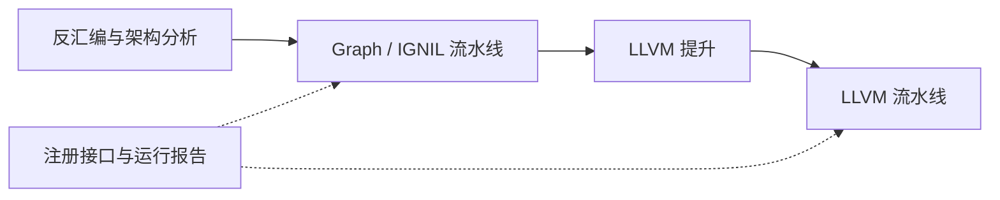

# 可组合的 Graph / LLVM Pass 流水线

后续[表内容证明修复](table-content-proof.md)改变跳转表发布前提，扩展了 FiniteDispatch
的 hints 路由、内存预算和 Python 回调快照/错误清理。本文首版历史验证数字保持原样；
当前使用新增可信读取契约时，还须遵守下面的注册生命周期说明。
内容复验 Incomplete 时也可能撤回旧推断并报告 `changed=true`。分析撤回作用于整个 Graph，
但本次重新证明只覆盖传入代码 region，其他 region 的旧推断不会自动恢复。

基线 `04c6d91`，2026-11-06。第一版提供进程内注册、参数配置、阶段检查、
有预算的重复执行、分析缓存和结构化报告。新算法可以用 C++ 可调用类、C 回调或
Python 可调用对象接入；本版不加载共享库插件。有限值集、分发器专门化和证明型去平坦化
复用这套接口；未知状态仍保持显式 CFG。
C/Python 插件可编排现有变换及分析；直接访问并改写 Graph/LLVM 数据结构使用 C++ 上下文接口。

显式 [guarded entry view](llvm-guarded-entry.md) 可作为独立 `LLVMLifter` 运行这些步骤。
它检查候选入口字节并保留普通回退，使用者必须选择 manifest 的新增入口符号。
原始模块和默认配方不变；成功检查后的条件化简不代表无条件恢复了整个分发器。
可在该视图的原始 IR 上先运行一次显式 [entry-prefix](llvm-entry-prefix.md)，
隔离检查成功后的首次执行前缀，再运行内存和控制流配方。复制预算按整个模块累计；
未知调用和循环回边继续进入原块，不能把首次入口收益解释为完整去平坦化。

## 两个运行位置



同一 `PassPipeline` 类型提供 Graph 和 LLVM 两种运行接口。一次运行只接受同一阶段的
步骤；混合阶段在执行任何步骤前拒绝。Graph 阶段处于初始反汇编分析之后、LLVM 提升之前，
初始反汇编器的默认目标解析策略保持兼容。可选的有限值集恢复通过专用分析钩子
允许候选增长并最终复验；其他恢复目标、补充解码等算法也可以
注册为 Graph Pass。LLVM 阶段复用现有优化实现。

内置步骤：

| 名称 | 阶段 | 参数 |
|---|---|---|
| `graph-audit` | Graph，读取统计 | 无；报告指令、有效块/函数、缺失 IGNIL 和按块累加的 unlifted 记录数 |
| `finite-values` | Graph，只读分析并缓存 | `max_values=64, max_blocks=4096, max_operations=1000000, max_facts=262144` |
| `mem2reg` / `instcombine` / `gvn` / `dce` | LLVM | 无 |
| `entry-prefix` | LLVM，显式选择 | `max_blocks=32, max_instructions=2048`；仅限 StaticAnalysis，复制有界首次入口前缀，拒绝或预算耗尽报告 Incomplete；硬上限 4096/65536 |
| `guest-memory` | LLVM，显式选择 | `max_rewrites=65536, run_mem2reg=1, enable_cross_block=1, enable_phi=1, consume_call_effect_summaries=0, edge_worklist=0`；复用现有 GuestMemorySSA，标志只接受整数 0/1 |
| `control-flow` | LLVM，显式选择 | 无；SCCP、状态机/普通跳转穿线、CFG 与死代码清理。详见 [控制流清理](llvm-control-flow-cleanup.md) |
| `dispatch-specialize` | LLVM，显式选择 | `max_conditions=256, max_expression_nodes=128, allow_plain_stores=0`；唯一常量条件才改写，未知/多值保持原样；条件或表达式预算退出报告 Incomplete |
| `dispatch-deflatten` | LLVM，显式选择 | `max_dispatchers=64, max_incoming_edges=512, max_expression_nodes=128, max_values=16`；只改写状态 PHI 的有限值集合全部指向同一 switch 目标的可证明边 |
| `mba` | LLVM | `timeout_ms=100, max_queries=16, max_expression_nodes=128, max_variables=3, resource_limit=1000000` |
| `predicates` | LLVM | `timeout_ms=25, max_queries=64, max_expression_nodes=256, resource_limit=200000` |

`graph-audit` 是统计步骤，不能把其成功状态当作 CFG 完整性或执行正确性的证明。
配置是扁平的整数、布尔值、字符串对象；内置数值参数仅接受 uint32 整数，拒绝未知参数。

## Python 使用

```python
with dragon.PassPipeline(['graph-audit']) as graph_passes:
    graph = image.disassemble(graph_pipeline=graph_passes)
    # 裸字节也可用 dis.analyze(code, base, graph_pipeline=graph_passes)。

with dragon.LLVMLifter(image.architecture,
        execution_mode=dragon.LLVMExecutionMode.STATIC_ANALYSIS) as lifter:
    assert lifter.lift(graph.get_function(entry), graph)
    with dragon.PassPipeline([
        'mem2reg', 'instcombine', 'gvn',
        ('mba', {'max_queries': 16}), 'predicates', 'dce'
    ]) as pipeline:
        report = pipeline.run(lifter, max_iterations=4, max_pass_runs=32)
```

`lifter.optimize()` 现在经过默认流水线，仍按
mem2reg → instcombine → GVN → MBA → predicates → DCE 执行一轮，参数和 None 返回值保持兼容。
它仍调用公开的 `run_*` Python 方法，既有监测钩子继续生效。
`lifter.optimize(pipeline)` 执行指定流水线并返回报告。

Guest 内存和状态检查可以使用下面的有界顺序。先规范化寄存器及地址表达式，再消费
内存关系；后续轮次能消费上轮状态路径复制后出现的新关系。

```python
with dragon.PassPipeline([
    'mem2reg', 'instcombine', 'gvn',
    ('guest-memory', {'run_mem2reg': 0}),
    ('dispatch-specialize', {'allow_plain_stores': 1}),
    'control-flow', 'dce'
]) as pipeline:
    report = pipeline.run(lifter, max_iterations=3, max_pass_runs=32)
```

这段配方显式运行最多三轮，每次调用重新使用该 pass 的预算；它不代表一般循环内存
不动点或完整去平坦化。逐项检查 `runs` 中的 Incomplete/Unavailable，不能仅凭
`ok` 或 `converged` 宣称分析完整。默认六步优化仍独立保留。

`guest-memory` 通过现有无 Graph 的 `LLVMLifter` 方法执行，不提供依赖 Graph 的
`prove_leaf_calls`/`max_call_*` 参数；需要此类证明时使用既有 Graph overload。
`consume_call_effect_summaries=1` 仅消费经过验证的元数据。新名称保留了已有插件
注册 `guest-memory-ssa` 的空间。所有内置参数受流水线 uint32 值域限制；这比独立
GuestSSA 接口的 `size_t maxRewrites` 更窄。`max_rewrites=0` 不禁止显式启用的
mem2reg 预处理，`Result.changed` 仍以实际 IR 变化为准。

可调用类就是一个插件；例如一个只读统计步骤：

```python
class FunctionCount:
    def __call__(self, context, options):
        addresses = tuple(context.target.function_addresses())
        context.analyses['function-addresses'] = addresses
        return dragon.PassResult(counters={'functions': len(addresses)})

with dragon.PassPipeline(['graph-audit']) as pipeline:
    pipeline.register('count-functions', FunctionCount(),
                      stage=dragon.PassStage.GRAPH, read_only=True)
    pipeline.add('count-functions')
    report = pipeline.run(graph)
```

`register(..., requires=('other-pass',))` 要求依赖步骤在同一流水线中先出现；不会自动插入或执行依赖。
依赖步骤执行过，并不表示它的旧分析结果仍然有效。插件须按当前 revision 查询缓存，
缓存缺失时重新计算。C++ 和 Python 各自保存其语言中的分析对象，不自动互换 `std::any` 与 Python 对象。

## C++ 和 C

公共头：`dragon/passes/PassPipeline.hpp`。

```cpp
using namespace dragon::passes;
PassPipeline pipeline;
for (const auto &name : PassPipeline::defaultLLVM())
    if (!pipeline.add(name)) throw std::runtime_error(pipeline.lastError());
Report report = pipeline.run(lifter);
if (!report.ok) throw std::runtime_error(report.error);
```

通过 `registerGraph(name, callable, readOnly, requiresPasses, validator)` 或
`registerLLVM(...)` 注册原生可调用类。上下文分别包含 `Graph&` / `LLVMLifter&`、
本次运行的 `AnalysisCache&`。缓存提供 `put<T>`、`get<T>` 和 `invalidate()`。
C++ validator 可返回错误说明，拒绝该步骤的配置。

FiniteDispatch 的新注册重载可复制 `AnalysisHints`，合并其入口与显式入口，并在重新分析
时使用同一份 `readKnownMemory` 契约。C++ 复制的是 `std::function`，不是其闭包中所有借用
资源；调用者仍须维持捕获引用有效。内存证明与其他有限分析共享每轮预算，缓存只在本轮
不变 CFG 内复用；预算/Unknown 不会回退到更宽松的默认分析。

C 接口提供 opaque `dragon_pass_pipeline_t`，create/register/add/run/describe/destroy，
阶段、状态和回调类型在 `dragon_c.h` 中。run 返回自有 JSON 字符串，须用
`dragon_cstr_free` 释放。回调目标是本次运行借用的 Graph/lifter；不得关闭或销毁它。
回调输出默认 ERROR，完成填写其他字段后必须显式设置状态。输出字符串须保持有效，
直到本次回调返回给框架并完成复制。Python 桥接负责这些缓冲区的生命周期。

C 的 `dragon_pass_pipeline_register_finite_dispatch_with_hints` 复制 hints，但 reader 的
函数指针/userdata 仍借用到 executor 被替换或 pipeline 销毁；`clear` 只清步骤。
新可信 reader 返回负数使原生调度器立即产生 ERROR 并停止后续步骤，0/其他正数表示
Unknown，只有 1 表示有效内容。这不改变原普通 image reader 的返回协议。

Python `register_finite_dispatch(..., hints=hints)` 为两种 reader 创建独立桥和错误列表，
持有注册时的回调对象与入口副本。随后替换/关闭原 hints 不影响注册；成功 override/close
释放失效快照，run 的 finally 清理错误引用。快照不深复制回调捕获的可变数据。
可信 reader 异常导致 `PipelineError`，原错误保存在 `__cause__`；失败目标仍须丢弃，
不能把错误后的 Graph 当作已验证结果。外部持有异常/traceback 时，它可继续保留 reader。

## 调度、缓存和失败规则

- `max_iterations` 默认 1，允许 1–64；设大于 1 时最多执行指定轮数，完整一轮无变化即停止。
  `max_pass_runs` 默认 64，允许 0–4096；0 表示不执行步骤。
  预算限制调度次数，不会强制中断任意插件代码；算法仍须有自己的求解和展开预算。
- 每次 Pass 调用重新取得它自己的选项预算，多轮运行会重复取得这些预算。
  默认一轮保留原先的每模块预算；没有把多次调用伪装成一次求解。
- 修改型 Pass 执行后保守清空全部缓存，即使这次没有实际改变 IR。只读步骤可共享缓存。
  插件在步骤内部修改目标后若还要查询分析，也须自行失效相应缓存。
  每次 run 都创建全新缓存，不跨目标或跨运行复用旧事实。
- LLVM 步骤用调用前后的完整 IR 文本检测变化，涵盖常量、全局、属性和元数据。
  Graph 插件负责如实报告 `changed`；不能将其声明为只读后修改 Graph。
- 默认在 LLVM 运行前和每一步后 verify。只读 LLVM Pass 修改 IR、Unavailable Pass 修改 IR、
  无效状态或无效 LLVM 输出都会停止流水线。verify 是结构检查，不能证明程序语义等价。
- 报告包含 `ok / changed / converged / budget_exhausted / iterations / error / runs`，每次调用记录
  名称、轮次、revision、状态和计数器。SUCCESS 只表示调用正常；UNAVAILABLE 表示缺少能力，
  INCOMPLETE 表示该步骤未完成全部证明；ERROR 停止执行。`ok` 或 `converged` 都不表示混淆已全部消除。
- Pass 是可信进程内代码，需自行满足变换前提、证明义务和回归对拍要求。框架没有为任意
  插件建立通用语义证明器或隔离边界。错误不自动回滚；应丢弃发生错误的处理产物。
- 禁止同一流水线递归执行和运行中修改注册/步骤。Python 也禁止对同一目标嵌套运行，
  以及关闭运行中的流水线或目标。对象不提供并发运行保证。
- Python Graph 流水线调用会使先前借用的 Instruction/BasicBlock/Function/IGNILBlock 视图过期，
  后续访问抛 ReferenceError；应在运行后重新获取。自动 `graph_pipeline=` 路径在失败时关闭
  新建 Graph。所有语言的插件都不得在修改后复用此前获取的视图或 IR 指针；需要时重新获取。

## 验证

- 八项新的 C++ 回归 / 158 条断言；配置、阶段、前置步骤、循环预算、缓存失效、错误停止、
  Graph 扩展和 LLVM 非法输出均有覆盖。默认 sweep 与原始手动调用在三架构上逐字节一致。
- 原基线不能编译新增 API 测试，错误是缺少 `PassPipeline.hpp`；原始输出保留。
- 开发中的异常回归另外抓到错误文本格式化失败被 CFFI 忽略、未填写的 C 回调结果被当作成功，
  以及关闭活动目标造成的崩溃。最终实现默认失败、最后提交成功状态，并阻止 Python 目标关闭；
  对应旧日志和修复后回归都保留。初轮验证产物归档，未计入最终覆盖。
- CTest 582/582；无 Z3 458/458。
- 自定义类 Pass 与 Graph 缓存步骤：3776 次状态比较匹配，包含 1040 次完整根返回、
  480 次既定边界和 2256 次错误入口拒绝。另一个有预算的重复流水线：976 次匹配，
  包含 400 次完整根返回、576 次拒绝入口。边界和拒绝入口不算完整函数成功。
- 返回寄存器、内存负对照各检测 84/84 个单字段差异。无 Z3 的自定义流水线另外有
  84 次匹配（36 次完整根返回、48 次拒绝入口）。没有新增排除、跳过或归一化。
- 同一批冻结的 Tigress 二进制，三档 × C O0/O2 × 两种策略 × 两种入口策略 × MBA 开/关：
  48 份 kernel IR 与原先的手动管线逐字节一致。新架构不把这些相同行为称作新增去混淆收益。
- 冻结 Tigress 样本的完整执行复验：288 次 C 参考比较、576 次 LLVM 完整根返回匹配；
  错误、未完成退出、unlifted 和执行到未解码指令均为 0。仍执行真实 Guest megaInit，
  没有注入初始化后的堆数据来帮助分析。
- 两个真实语料库全部重跑：69 个输入、138 种策略组合、206649 个有效函数检查点；
  6530 份原始模块和 6530 份优化模块全部 verify，提升失败和函数覆盖缺口均为 0。
  输入哈希、反汇编/CFG/函数覆盖等记录字段与基线一致，保留已有异常。
  138 次 Graph 和 6530 次 LLVM 流水线报告均检查了步骤、状态和预算；
  MBA 合计 8 次查询、8 次已证明改写、0 unknown、0 拒绝。普通代码计数也包含状态/标志辅助表达式。
- 资源中断单独保留：两个大输入并行时 VM 交换空间耗尽，主动终止了尚未完成的 Python 输入。
  该次不计最终覆盖；改为大输入串行后单独完整重跑通过。记录在 `memory-retry/`，
  最终汇总要求该输入存在完整结果，没有跳过它。

VM 产物：`~/vmc-runs/pass-pipeline-20261106/`。本轮没有修改指令提升器、IGNIL 优化算法
或间接跳转解析策略，未另跑单指令/IGNIL 全量差分。原生函数验证覆盖调度后的执行结果；
真实语料的 verify 只能证明 IR 合法性。上述为架构首版验证；后续有限值集恢复的独立验证见
[组件记录](finite-dispatch.md)。后续有限值集支持可选的[叶函数效果证明](leaf-call-effects.md)；
一般跨调用分析、堆建模和去平坦化仍需后续组件。
